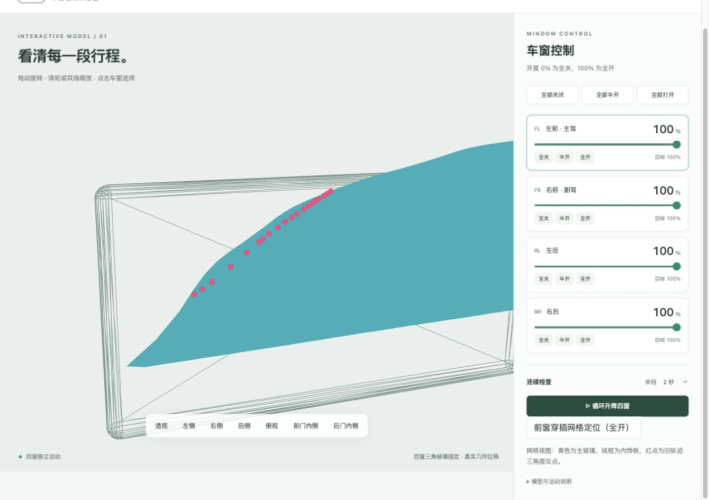
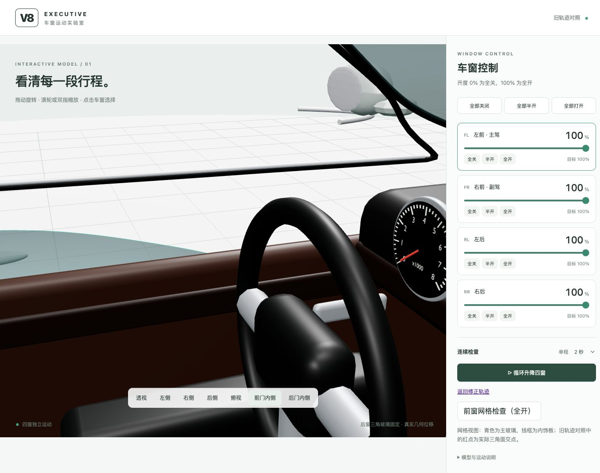
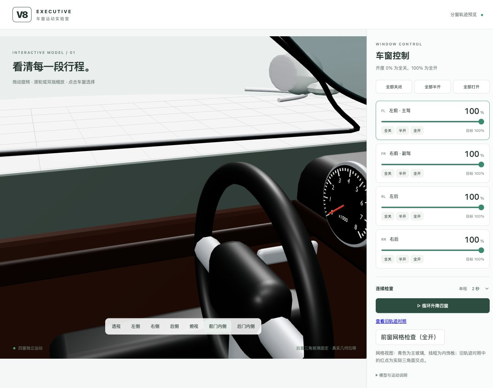
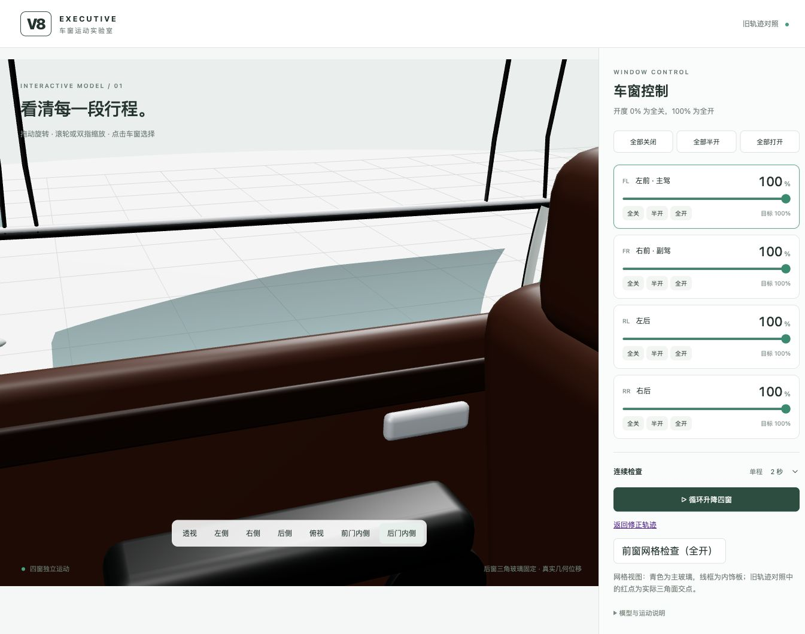
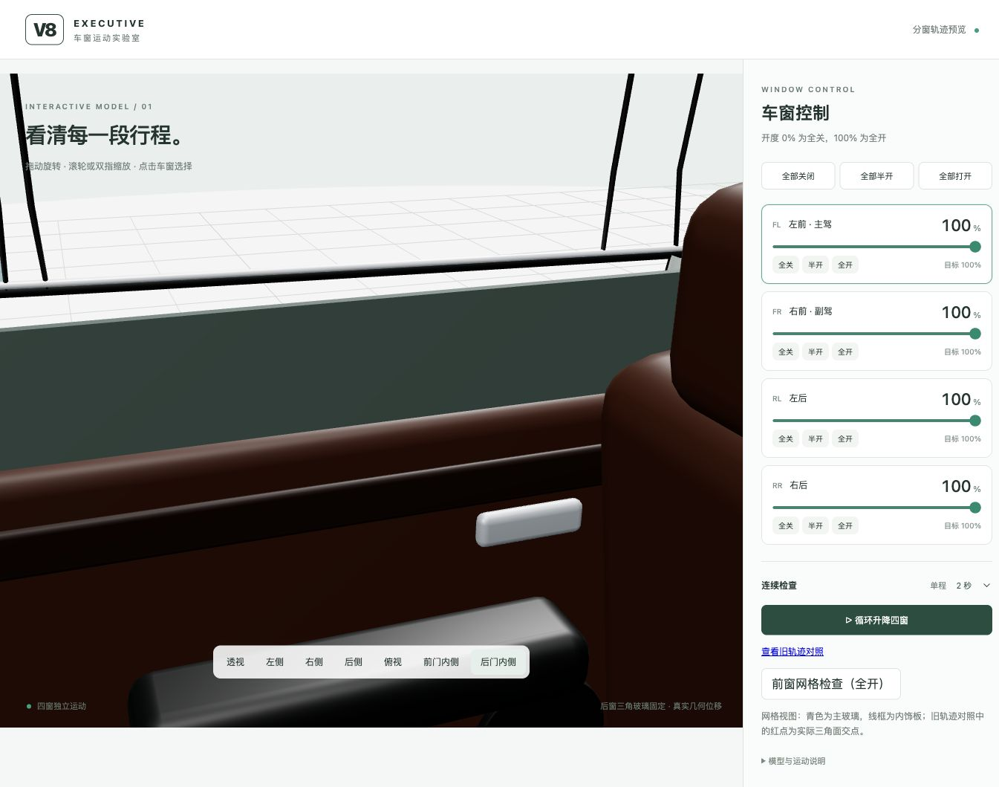

# V8 分窗运动与门腔修正记录

预览：http://127.0.0.1:5173/ 。旧模型 + 旧轨迹对照：http://127.0.0.1:5173/?baseline=1 。

本次解决对象：前主玻璃穿插门皮/内饰板、四窗全开后从车内露出玻璃上缘。原始 FBX、Blend 和拆分 FBX 未改动；运行时加载的工作副本由原始 FBX 加静态几何补丁组成。没有减面，也没有用隐藏主玻璃、改变透明度或动态裁切来模拟升降。

## 实际网格判断

原始主玻璃在厘米坐标下的包围尺寸：前窗约 105.00 × 42.48 × 13.42，后窗约 64.00 × 40.48 × 12.56（X/Y/Z）。前窗前缘还有明显的曲面形状变化，因此两者不应共用下降量与倾角。

旧轨迹每窗统一下降 46 cm / 倾角 17°，有以下实测问题：

1. 前窗全开时，玻璃与 `Door_FL__V8_DoorCard_DoorFrontL` 检出 80 对非共面三角面相交。网格截图红点来自真实边—三角形交点，不是包围盒中心。
2. 新轨迹初调阶段，前窗内饰板交点集中在 X 约 46–58 cm，Y 约 58–87.5 cm；外门皮中间行程交点集中在 X=-31 cm 的 B 柱侧接缝。前移 0.6 cm 后避开此接缝。
3. 每 1% 开度检查发现，四窗在初始 1%–4% 还会穿过门皮上沿的封面。前窗交点约 Y=97.1–99.4、|Z|=87.2–88.1 cm；后窗约 Y=99.2–100.9、|Z|=87.1–87.4 cm。需要在实际网格上开出升降通道。
4. 原内饰板最高约 87.5 cm，旧全开玻璃仍高达约 95 cm；从车内能看到一段独立的青色玻璃上缘。这既与行程不足有关，也与内饰板至窗腰的缺口有关。

## 分开的轨迹

详见 `src/config/v8-windows.ts` 的 `frontTrack` 与 `rearTrack`；右侧按车辆自身左右镜像。

| 参数 | 前窗 | 后窗 |
| --- | --- | --- |
| 总下降量 | 57 cm | 55 cm |
| 最终倾角调整量 | 12° | 18° |
| 前后方向避让 | 向车头 0.6 cm | 0 |
| 横向避让 | 后半程分段向外，最大 2.75 cm，最终 2.5 cm | 0 |
| 最终玻璃顶部 | 约 83.84 cm | 约 86.12 cm |

0–100% 是规范化全行程；由于玻璃需要继续进入门内，全行程的 50% 不等于可见窗洞面积恰好打开一半。每条轨迹含 0%、10%…100% 关键帧，运动参数与几何补丁分开保存。

## 工作副本上的局部调整

`model-review/v8-working/door-cavity.patch.json` 保存实际三角网格，不是随开度变化的裁切规则。

- **两块前内饰板背面局部让位**：在 X=38–68 cm、Y>46 cm 的区域平滑过渡；最大让位 3.8 cm。保持面向车内的原主表面不动，局部细分背面三角网格，为前窗曲面留出空间。
- **四扇门上沿开窄槽**：只切掉玻璃路径穿过的静态封面区域；前槽宽约 1.4 cm，后槽约 0.9 cm，精确范围见补丁 `slots`。不删除整扇门、不隐藏车身来遮掩问题。
- **补齐内侧门腰板**：新增四块固定、具有厚度的 `Working_*_InnerBelt` 网格，与升降状态无关。前侧高度 87.3–99 cm，后侧 87.3–100.5 cm，填补原内饰板顶部到窗腰之间的缺口。
- 主玻璃与后窗三角玻璃的几何未修改。三角玻璃始终保持原变换。

生成补丁：`node model-review/v8-working/build-cavity.mjs`。
加载补丁：`src/scene/apply-cavity.ts`。
原始 FBX SHA256：`56df7214c057bcde046b324078721f9e6cde761838a29ec086aed08efd35193c`，仍匹配作者随附校验和。

## 截图

前窗穿插定位（修正前，红点是三角面交点）：

前门内侧，修正前：

前门内侧，修正后：

后门内侧，修正前：

后门内侧，修正后：

其他过程截图在同目录，包括左侧约 25%、50%、76% 和右侧反向升窗半程。动态截图以图内实时数值为准。

## 验证

- `npm run build`：类型检查与生产构建。
- `node scripts/check-v8.mjs`：独立状态、中途反向、暂停、固定三角玻璃、原模型校验和以及刚体运动检查。
- `node model-review/v8-working/check-motion.mjs`：4 窗 × 101 开度；逐窗检查主玻璃与对应外门皮、内饰板、新增门腰板。结果写入 `current-collisions.json`，发现相交会以非零状态退出。
- 当前上述 404 个姿态未检出非共面三角面相交。检查包含实际工作副本网格，非仅包围盒。
- 浏览器执行了 10 秒单程升降，观察左右外侧、内侧全开及半开，并保留截图。

边界：有限采样不等于连续碰撞证明；测试未穷举全部车身、密封条、附件及任意观察机位。包围盒检查在凹形内饰板上仍可能报告落入包围盒的顶点，这不代表穿过实际面，应以三角面检查与视觉检查共同判断。新增门腰板和槽口属于演示用局部建模，后续仍可继续做外观精修。
